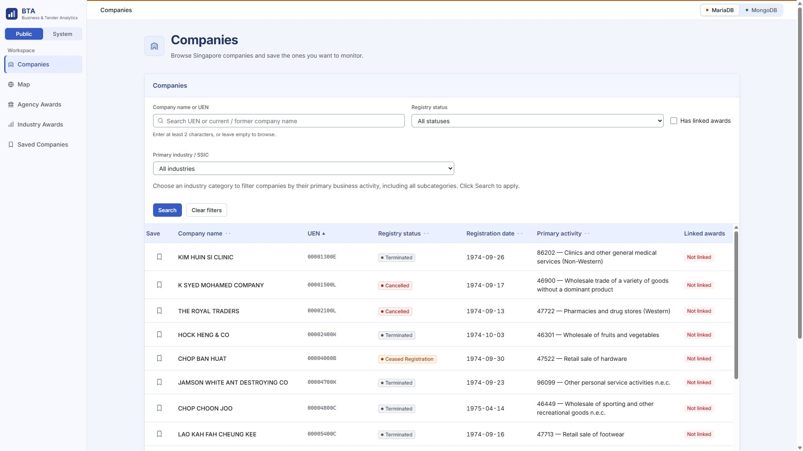
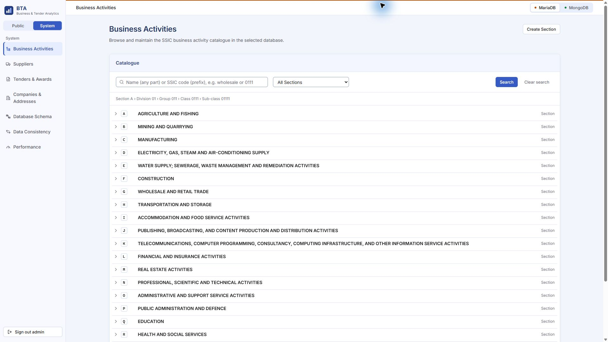

<h1 align="left">Business and Tender Analytics</h1>

<p align="left"><strong>BTA · INF2003 Database Systems Project</strong></p>

<p align="justify">Business and Tender Analytics is a web application that connects Singapore company registration information with government procurement data. It provides a common interface for exploring companies, their registered addresses and business activities, and their relationships with suppliers and tender awards. The application combines public browsing and analysis with authenticated record management and database comparison tools.</p>

<p align="justify">This documentation explains what the project implements, how its components fit together, and how to configure, run and validate a local installation. The setup commands are written for Windows PowerShell and should be executed from the repository root unless stated otherwise.</p>

## Contents

1. [Project overview](#1-project-overview)
2. [System architecture and repository structure](#2-system-architecture-and-repository-structure)
3. [Application functionality](#3-application-functionality)
4. [Software requirements](#4-software-requirements)
5. [Installation and database setup](#5-installation-and-database-setup)
6. [Running and using the application](#6-running-and-using-the-application)
7. [Company mapping and OneMap](#7-company-mapping-and-onemap)
8. [Testing and database evaluation](#8-testing-and-database-evaluation)
9. [Deployment considerations and limitations](#9-deployment-considerations-and-limitations)
10. [Troubleshooting](#10-troubleshooting)
11. [Supporting documentation](#11-supporting-documentation)

<p align="justify"><strong>Already set up?</strong> Go to <a href="#6-running-and-using-the-application">Running and using the application</a>. For a new installation, follow <a href="#4-software-requirements">Software requirements</a> and <a href="#5-installation-and-database-setup">Installation and database setup</a> first.</p>

## 1. Project overview

### Purpose and scope

<p align="justify">Company registration and procurement records describe related parts of the business landscape, but are less convenient to explore separately. This project brings them together so users can search for a company, understand its business classification, inspect available procurement links and analyse awards by agency or industry. The imported company dataset contains approximately 2.1 million records; the exact counts depend on the dataset version and subsequent changes.</p>

<p align="justify">A central objective is to implement corresponding application functions with both MariaDB and MongoDB. The project therefore includes database design, data preparation, query implementation, CRUD operations, validation, integration and testing. The comparison extends beyond displaying the same records: the application exposes schema information, detailed consistency checks and configurable performance workloads to help examine the consequences of the two data models.</p>

### Data used

| Dataset | Information represented | Role in the application |
| :---: | :---: | :---: |
| ACRA company registration data | UEN, company name, registry status, registration information, addresses and former names | Company browsing, details, administration and mapping |
| SSIC catalogue | Industry codes, descriptions and classification hierarchy | Business activity management, industry filtering and award analysis |
| GeBIZ procurement data | Tenders, government agencies, suppliers and tender awards | Procurement browsing, supplier links and award aggregation |

<p align="justify">Supplier-to-company links support navigation between procurement and registration information. A supplier record should not automatically be interpreted as a confirmed company match; the stored matching information determines the available relationship. Both databases should be restored from matching dataset versions before their results are compared.</p>

## 2. System architecture and repository structure

### Architecture

<p align="justify">The application separates presentation, application logic and data storage. React provides the interface, FastAPI processes requests and applies validation and authentication, and the selected database implementation retrieves or changes the business records. The frontend and backend run as separate processes during local development.</p>

```text
Browser: React + Vite + TypeScript
                 |
                 | HTTP /api requests
                 v
          FastAPI backend
          /             \
     MariaDB           MongoDB
```

### Database behaviour

<p align="justify">MariaDB stores related information in 12 tables. MongoDB represents the corresponding information in seven collections, embedding selected data such as company addresses, former names, activities and tender awards.</p>

- **Database selection:** Ordinary browsing and record-management operations use the selected database. Editing a company, supplier or tender in one database does not automatically copy that edit to the other database. Schema, consistency and performance pages inspect or compare both implementations.
- **Saved companies:** Bookmark membership is retained in browser storage and mirrored to saved lists in both databases. This does not copy company records. Synchronisation requires the company to exist in the target database and that database to be reachable; use the retry option if synchronisation is incomplete. This is a browser-based feature, not an account-based service shared across devices.
- **Model differences:** MariaDB supports multiple addresses per company, while the current MongoDB company document stores one address object. These differences matter when interpreting comparisons after database-specific edits.
- **Mapping:** Leaflet displays OpenStreetMap tiles. SLA OneMap resolves address information into coordinates. A local SQLite cache stores derived map data; it is separate from the source company records and requires no additional database server.

### Repository structure

```text
INF2003-Database-/
├── backend/
│   ├── app/
│   │   ├── routes/          # API endpoints and authentication
│   │   ├── system/          # Database-specific operations and diagnostics
│   │   ├── config.py        # Environment configuration
│   │   ├── databases.py     # Database connections
│   │   └── main.py          # FastAPI application entry point
│   ├── scripts/             # Optional map utilities
│   └── tests/               # Backend unit and API integration tests
├── frontend/
│   ├── src/                 # React pages, components and application state
│   ├── tests/               # Frontend regression tests
│   ├── package.json         # Frontend dependencies and scripts
│   └── vite.config.ts       # Development server and API proxy
├── docs/
│   ├── images/              # README screenshots
│   ├── testing/             # Regression check documentation
│   └── company-map.md       # Mapping implementation and usage guide
├── scripts/                 # Database maintenance utilities
├── sql/                     # MariaDB schema and migrations
├── .env.example             # Local configuration template
├── .gitignore               # Files excluded from version control
├── requirements.txt         # Python dependencies
└── README.md                # Project documentation and setup guide
```

<p align="justify">The backend's routes expose the HTTP interface, while its database-specific logic implements the corresponding operations for MariaDB and MongoDB. The frontend consumes those endpoints and manages navigation, filters and selected-database state. SQL files support relational schema creation and upgrades; the documentation and test folders describe and verify application behaviour.</p>

<p align="justify">Local configuration belongs in the repository-root <code>.env</code>. Dependencies are installed from the supplied manifests, datasets are restored from the project data package, and derived map caches are generated locally. The installation sections below explain these steps in the order needed to run the application.</p>

## 3. Application functionality

<p align="justify">The interface is divided into Public and System views. The Public view supports exploration and analysis without administrator sign-in. The System view provides authenticated maintenance and diagnostic tools. Both use the same frontend and backend, with database-specific operations handled behind the API.</p>

### Public view

<p align="justify">The Public view provides the main company directory and analysis features. The example below shows company search, industry and status filters, and the results table alongside the public navigation.</p>



<p align="center"><em>Public view: company browsing and filtering.</em></p>

| Module | Features |
| :---: | :---: |
| Public — Companies | Search by UEN or current/former company name; filter by registry status, primary industry and linked awards; sort records and select the page size or page number. |
| Public — Company details | View available company information, addresses, business activities, former names, linked awards and address mapping. |
| Public — Saved companies | Bookmark companies, search and sort saved entries, remove entries and undo a recent removal. Bookmark membership is shared across database switches in the same browser. |
| Public — Company map | Search active companies by industry, explore clustered locations, follow the visible map area, and filter mapped or unmapped results. Location checks show progress and preserve uncertain source addresses. |
| Public — Award analysis | Explore agency and industry award analysis, including aggregated supplier awards and industry classifications. |

### System view

<p align="justify">The System view brings administrative modules and database diagnostics into a separate workspace. This example shows the SSIC catalogue, with access to company/address, supplier and tender management through the sidebar.</p>



<p align="center"><em>System view: business activity management and administrator navigation.</em></p>

| Module | Features |
| :---: | :---: |
| System — Record management | Create, view, update and delete records through the Business Activities, Suppliers, Tenders & Awards, and Companies & Addresses modules, subject to validation and relationship checks. |
| System — Database schema | Inspect database structures, relationships, collection designs, indexes and record counts. |
| System — Data consistency | Compare record counts and run a detailed comparison of the business data represented in both databases. Checks report differences; they do not synchronise records. |
| System — Performance | Compare company lookup, company profile retrieval, company name search, agency award aggregation and industry award aggregation workloads. |

<p align="justify">The database selector changes which implementation supplies ordinary browsing and maintenance results. The comparison tools deliberately inspect both databases. See <a href="#database-behaviour">Database behaviour</a> for the distinction between selected-database edits and shared bookmarks.</p>

## 4. Software requirements

<p align="justify">The commands below are for <strong>Windows PowerShell</strong>, run from the repository root. Install the required tools and ensure their commands are available on <code>PATH</code>.</p>

| Software | Project requirement / recorded version | Purpose |
| :---: | :---: | :---: |
| Python | 3.13 | FastAPI backend and Python scripts |
| Node.js and npm | Supported LTS release, 22.12 or newer | Frontend dependencies, development server and build |
| MariaDB Server | MariaDB 12; recorded setup uses 12.3.3 | Relational database |
| MongoDB Server | Recorded setup uses 8.3.11 | Document database |
| MongoDB Database Tools | Recorded setup uses 100.18.0 | `mongorestore` for the supplied archive |
| MariaDB command-line client | Compatible with the server | Schema and SQL data import |

<p align="justify">The recorded versions describe the project setup, not a guarantee that every other version has been tested. Python package versions are pinned in <code>requirements.txt</code>; frontend dependencies are defined in <code>frontend/package.json</code> and <code>frontend/package-lock.json</code>.</p>

<p align="justify">Use <strong>MariaDB Server</strong>, rather than assuming that a MySQL installation supports the supplied schema. The schema uses the MariaDB collation <code>utf8mb4_uca1400_ai_ci</code>.</p>

## 5. Installation and database setup

<p align="justify">Complete the steps in order for a new installation. If dependencies and datasets are already present, retain your local configuration, apply only any required migration, and continue to <a href="#6-running-and-using-the-application">Running and using the application</a>.</p>

### 5.1 Install application dependencies

<p align="justify">Open PowerShell in the cloned project folder:</p>

```powershell
py -3.13 -m venv .venv
.\.venv\Scripts\python.exe -m pip install -r requirements.txt
npm.cmd --prefix frontend ci
```

<p align="justify">The commands use the virtual environment's Python directly, so activating the environment is optional. <code>npm.cmd</code> also avoids PowerShell execution-policy errors associated with <code>npm.ps1</code>.</p>

### 5.2 Configure the environment

<p align="justify">Create the local configuration only if it does not already exist:</p>

```powershell
if (-not (Test-Path -LiteralPath .env)) {
    Copy-Item -LiteralPath .env.example -Destination .env
}
```

<p align="justify">Edit the repository-root <code>.env</code> with your local connection details:</p>

```dotenv
MARIADB_HOST=127.0.0.1
MARIADB_PORT=3306
MARIADB_USER=your_local_username
MARIADB_PASSWORD=your_local_password
MARIADB_DATABASE=inf2003_db_mariadb

MONGODB_URI=mongodb://127.0.0.1:27017
MONGODB_DB_NAME=inf2003_mongodb
```

<p align="justify"><strong>Use your actual MariaDB port.</strong> The example file uses <code>3307</code>; the block above illustrates <code>3306</code>. The import commands and backend configuration must connect to the same server and port.</p>

<p align="justify">Both database configurations are required when loading backend settings. The application expects the database names <code>inf2003_db_mariadb</code> and <code>inf2003_mongodb</code>. Process environment variables take precedence over values in <code>.env</code>.</p>

<p align="justify">Keep real credentials in local configuration. Do not commit <code>.env</code> or add credentials to screenshots or reports. Optional mapping credentials are described in <a href="#7-company-mapping-and-onemap">Company mapping and OneMap</a>.</p>

### 5.3 Restore the project datasets

<p align="justify"><strong>Skip this step if your databases already contain the current project data.</strong> Start both database services before importing or running the application.</p>

<p align="justify">Obtain the matching MariaDB data-only SQL dump and compressed MongoDB archive from the project's data/submission package. The large dataset files are not included in this checkout. Use the same dataset version for both databases so that consistency and performance comparisons are meaningful.</p>

<p align="justify">The examples below assume the supplied files have been placed in <code>C:\ProjectApp-data</code>. Replace the filenames with those in your package and change the MariaDB port if necessary. Use fresh project databases for the initial restore; the schema contains table-creation statements and is not an upgrade script for existing tables.</p>

#### MariaDB

<p align="justify">Create the schema first, then import the data-only dump. Run these commands from the repository root:</p>

```powershell
mariadb --host=127.0.0.1 --port=3306 --user=root --password --execute="source sql/INF2003_Grp1_database_schema_mariadb.sql"
mariadb --host=127.0.0.1 --port=3306 --user=root --password --database=inf2003_db_mariadb --execute="source C:/ProjectApp-data/inf2003_data_only.sql"
```

<p align="justify">Replace <code>root</code> with your import user if needed. <code>--password</code> prompts for the password without placing it directly in the command.</p>

#### MongoDB

```powershell
mongorestore --uri="mongodb://127.0.0.1:27017" --gzip --archive="C:\ProjectApp-data\inf2003_mongodb.archive" --nsInclude="inf2003_mongodb.*" --stopOnError
```

<p align="justify">The supplied archive contains the MongoDB records, supplier links, indexes and validators. A separate supplier-matching step is not required after restoring that archive. Use your configured connection URI if MongoDB runs elsewhere or requires authentication.</p>

#### Updating an older MariaDB installation

<p align="justify">Older project databases without bookmark timestamps require this migration once:</p>

```powershell
mariadb --host=127.0.0.1 --port=3306 --user=root --password --execute="source sql/20261016_saved_company_timestamps.sql"
```

<p align="justify">The migration adds the missing <code>saved_at</code> column if necessary and can be rerun safely. Fresh databases created with the current schema already include it. Do not rerun the full schema to apply this migration.</p>

## 6. Running and using the application

<p align="justify">Once dependencies, configuration and datasets are ready, start the application in <strong>two terminals</strong>, both opened at the repository root. Keep both database services running.</p>

### Terminal 1 — backend

```powershell
.\.venv\Scripts\python.exe -m uvicorn backend.app.main:app --host 127.0.0.1 --port 8000
```

### Terminal 2 — frontend

```powershell
npm.cmd --prefix frontend run dev -- --host 127.0.0.1 --port 5173 --strictPort
```

<p align="justify">Open <a href="http://127.0.0.1:5173"><strong>http://127.0.0.1:5173</strong></a> in your browser to use the application.</p>

<p align="justify">The frontend development server forwards <code>/api</code> requests to port <code>8000</code> through <code>frontend/vite.config.ts</code>. If you change the backend port, update that proxy target as well.</p>

<p align="justify">To stop the application, press <strong>Ctrl+C in each application terminal</strong>. This stops the frontend and backend processes; database services remain running separately.</p>

### Administrator access

<p align="justify">Select <strong>System</strong> to access the administrator sign-in screen. Use the administrator account configured for the project. Authentication is enforced by the backend as well as the interface, so protected API requests require a valid session. Restarting the backend clears its in-memory sessions and requires signing in again.</p>

### Suggested application walkthrough

1. Open **Public → Companies**, browse the records or apply a name/UEN search and filters, then open a company profile to inspect its available details.
2. Save a company and open **Saved Companies** to review the bookmark. Switch databases to check shared membership; displayed company information still comes from the selected database.
3. Open **Company Map**, select an industry and search. Review location-check progress, use the mapped/unmapped filters, and zoom or pan to explore the visible area. Mapping configuration is covered in the [next section](#7-company-mapping-and-onemap).
4. Use **Agency Awards** and **Industry Awards** to inspect procurement summaries rather than individual company records.
5. Sign in to **System** for record management, then use **Database Schema**, **Data Consistency** or **Performance** to inspect and compare the implementations. Ordinary maintenance changes affect the selected database, so a later consistency check can legitimately identify differences.

## 7. Company mapping and OneMap

### Purpose and location accuracy

<p align="justify">OneMap is used to obtain coordinates from Singapore addresses; it is not the application's company-data source. Company browsing and other database functions can run without OneMap credentials, but new location checks may pause until authentication is available.</p>

### Authentication configuration

<p align="justify">Set these optional values in the repository-root <code>.env</code>:</p>

```dotenv
ONEMAP_EMAIL=
ONEMAP_PASSWORD=
ONEMAP_ACCESS_TOKEN=
```

<p align="justify">Use your OneMap account email and password to allow token renewal, or supply an access token. A non-empty <code>ONEMAP_ACCESS_TOKEN</code> takes precedence and must be replaced when it expires. Keep these credentials on the backend and restart it after changing the environment configuration.</p>

### Location progress and cached results

<p align="justify">The map shows source-loading and location-check progress, with separate mapped, unmapped and pending states. Confirmed locations are cached for later searches. Historical, incomplete or ambiguous addresses are preserved rather than silently rewritten or assigned an unsupported pin. An active registration status does not establish that a company currently operates at its registered address.</p>

<p align="justify">Confirmed results are cached locally for subsequent searches. After changing company or address records, use <strong>Refresh source data</strong> for the affected industry and database to update the map snapshot. Cached results are derived from the source records and are not automatically refreshed after every edit.</p>

<p align="justify">See <a href="docs/company-map.md">Company map documentation</a> for matching rules, map-area filtering, caching, preparation and troubleshooting.</p>

## 8. Testing and database evaluation

<p align="justify">Validation combines frontend regression tests, backend unit and API integration tests, manual browser checks, and database comparison tools. Install the project dependencies first, and record the commands, environment and outcomes when reporting a test run. Integration checks require the running services and datasets described below.</p>

### Frontend regression tests

```powershell
node --test "frontend/tests/*.test.cjs"
```

<p align="justify">These cover behaviour such as navigation state, database switching, saved-company rendering, shared bookmarks and address-map handling.</p>

### Frontend production build

```powershell
npm.cmd --prefix frontend run build
```

<p align="justify">This runs TypeScript checking and the Vite build. The development proxy is not a production deployment configuration; serving the built frontend also requires an appropriate backend/API routing setup.</p>

### Backend tests

<p align="justify">Start the backend on port <code>8000</code> and make both project databases available, then run:</p>

```powershell
.\.venv\Scripts\python.exe -m unittest discover -s backend/tests -p "test_*.py" -v
```

<p align="justify">The suite includes API integration tests as well as validation, filtering, sorting, bookmark and mapping checks. Some checks require prepared data or optional map configuration. Integration tests may create and clean up test records, so run them against a local development/test installation rather than a database containing important independent edits.</p>

<p align="justify">For manual checks, verify public searches and pagination, company details, saving/removing across database switches, administrator CRUD and validation, map-area filtering, and layouts at different screen sizes. Additional regression notes are in <a href="docs/testing/company-regression-checks.md">Company regression checks</a>.</p>

### Data consistency checks

<p align="justify">Use <strong>System → Data Consistency</strong> to compare counts and then detailed records. Equal counts alone do not prove that field values and relationships match. Differences after edits to only one database should be investigated in that context.</p>

### Performance evaluation

<p align="justify">Use <strong>System → Performance</strong> to run equivalent read workloads against both databases. Record the selected workloads, repetitions, concurrency, duration and environment when reporting results. The benchmark measures database operations and associated backend processing, excluding browser rendering and HTTP response delivery; results should not be presented as full website response times.</p>

## 9. Deployment considerations and limitations

<p align="justify">This setup is intended for local project development and demonstration. Before production deployment, review administrator account configuration and replace in-memory sessions with an appropriate persistent session-management approach.</p>

<p align="justify">MariaDB transactions support committing or rolling back related writes together. MongoDB updates are atomic within a document, but operations spanning several documents are not covered by a multi-document transaction in the current standalone deployment. Application reference checks help maintain relationships, but do not provide the same guarantees as relational foreign keys or a transaction spanning all affected documents.</p>

<p align="justify">Production hosting also requires an explicit arrangement for serving the frontend and routing API requests, including appropriate HTTPS and deployment configuration. The Vite development proxy is provided for local development. A successful frontend build alone does not configure a hosted application.</p>

<p align="justify">Mapping depends on external address resolution and locally cached snapshots. Some historical or incomplete addresses remain unresolved, and source edits require a map refresh. These limitations should be considered when demonstrating the application or interpreting location coverage.</p>

## 10. Troubleshooting

| Issue | Check / action |
| :---: | :---: |
| Database could not be reached | Confirm that the selected database service is running and that the host, port, credentials and fixed database name in the backend configuration are correct. Restart the backend after changing its environment configuration. |
| Missing-setting error during backend startup | Supply all required MariaDB and MongoDB settings. Check process environment variables too, because they override `.env`. |
| Unknown collation `utf8mb4_uca1400_ai_ci` | Check the actual database server and version connected to by the import command. Use the supported MariaDB server/port; a MySQL instance or older MariaDB server may reject this collation. |
| Table already exists during schema import | The full schema is intended for a fresh setup. Use the relevant migration for an existing installation rather than rerunning table creation. |
| `node`, `npm`, `mariadb` or `mongorestore` not recognised | Install the corresponding tool, add its executable directory to `PATH`, then open a new terminal. |
| PowerShell blocks `npm.ps1` | Use the documented `npm.cmd` commands. |
| Port `5173` or `8000` is in use | Stop the earlier application process in its terminal, or identify the conflicting service. Keep frontend proxy and backend ports aligned if changing the setup. |
| Administrator API returns `not_authenticated` | Sign in through the System view. A direct browser request without the application's authentication token is expected to be rejected. |
| Saved companies have incomplete synchronisation | Ensure both databases are reachable and the company exists in both, then retry. Bookmark mirroring does not import a missing company. |
| Map checks pause or locations are unavailable | Check OneMap authentication and network access. Some source addresses cannot be resolved confidently even with valid credentials. |
| Map does not reflect a recent source edit | Refresh source data for the relevant industry/database. Cached map results are derived snapshots. |

## 11. Supporting documentation

<p align="justify">The README provides the complete local setup sequence. The following files contain more focused implementation and verification information.</p>

| Resource | Contents |
| :---: | :---: |
| [Company map guide](docs/company-map.md) | Address matching, map-area behaviour, location preparation, caching and mapping-specific checks |
| [Company regression checks](docs/testing/company-regression-checks.md) | Company search, sorting, pagination and database-switching regression notes |
| [Environment template](.env.example) | Required database settings and optional OneMap configuration |
| [Python dependencies](requirements.txt) | Pinned backend packages |
| [Frontend manifest](frontend/package.json) | Frontend dependencies and available development/build scripts |
| [MariaDB schema](sql/INF2003_Grp1_database_schema_mariadb.sql) | Relational table definitions, constraints and indexes |
| [Bookmark timestamp migration](sql/20261016_saved_company_timestamps.sql) | Upgrade for older MariaDB saved-company entries |

<p align="justify">For connection, import or startup errors, use <a href="#10-troubleshooting">Troubleshooting</a>.</p>

<details>
<summary><strong>Optional backend developer endpoints</strong></summary>

<p align="justify">The backend also provides <a href="http://127.0.0.1:8000/docs">/docs</a>, generated by FastAPI for inspecting endpoint schemas, and <a href="http://127.0.0.1:8000/health">/health</a>, implemented by the project to report database reachability. These are developer utilities available while the backend is running, rather than pages in the application's navigation. A connectivity result does not verify dataset completeness or matching content.</p>

</details>
